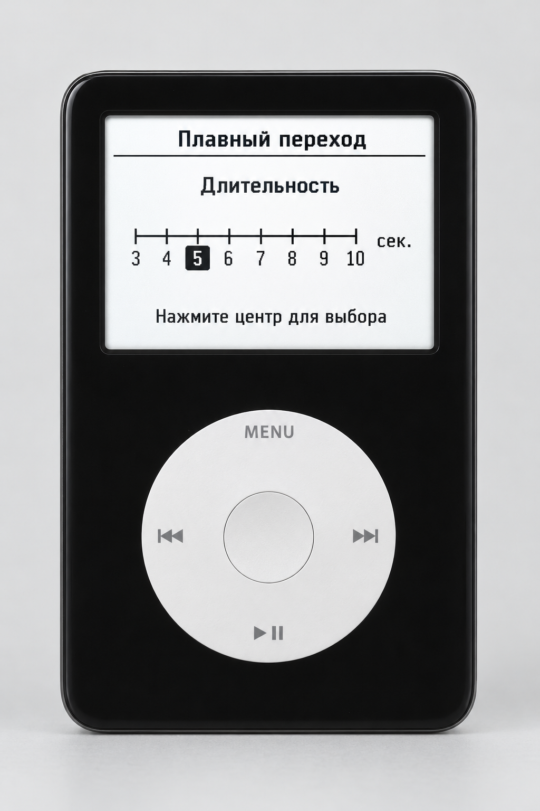

# Макет «Плавный переход»

Это визуальный макет, а не снимок работающей прошивки. Он фиксирует согласованный вариант экрана для iPod Video 5.5G:

- пункт Settings: «Плавный переход»;
- шкала длительности: целые значения от 3 до 10 секунд;
- поворот Click Wheel передвигает выделение на соседнее значение;
- нажатие центральной кнопки сохраняет выбор;
- MENU возвращает назад без изменения текущего значения.

При реализации нужно сохранить штатный вид списка RetailOS и использовать существующие механизмы локализации и хранения настроек. Для макета выбрано значение 5 секунд; это только начальное состояние изображения, а не окончательное значение по умолчанию.
